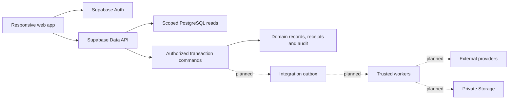

# Application architecture

The React and TypeScript client uses Supabase Auth with active organization membership. Reads use the Data API under PostgreSQL grants and RLS. Mutations involving workflow, identity, financial state or record ownership use explicitly authorized transaction commands. The application uses the same records and command contracts across the responsive PWA and future native clients.

The implemented web stack and database tables are listed in [the current repository setup](../README.md) and [database schema](schema.md). The master brief specifies the additional client libraries, provider adapters and mobile functionality required before release. Domain ownership, approvals and idempotency are enforced in PostgreSQL so alternate clients use the same authorization and state rules. Local, staging and production credentials are isolated, with service credentials limited to trusted server processes. See [architectural decisions](DECISIONS.md) and [access model](permissions.md).
