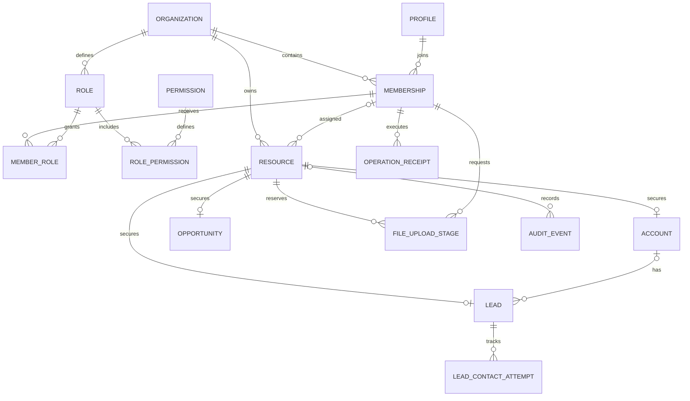

# Entity relationships

## Foundation and existing CRM slices

Each resource is associated with its matching typed row. Same-organization relationships use composite foreign keys where applicable. The private file staging record identifies its exact parent resource and requesting membership. The [migration dictionary](schema.md) covers implemented constraints.

## Phase 1 extensions

- Accounts contain sites and installed equipment. Contact links allow associations with multiple hospital sites. Lead products, tasks, quotes, demonstrations and orders link to their relevant leads and customers.
- Visits associate multiple contacts and leads, with discrete attendance or GPS events and versioned reporting where applicable.
- Tenders contain lots, compliance rows, deadlines, document checklists, submissions and securities. Awarded lots and ordinary opportunities can reference the same canonical booking for reporting.
- Expense claims have versioned lines, receipts, decisions and a reimbursement ledger. Provider invoice and payment allocations retain their source identifiers for reconciliation.

The [SRS](SRS.md) contains the complete logical dictionary. Planned relations require migration constraints and acceptance tests before they become available.
